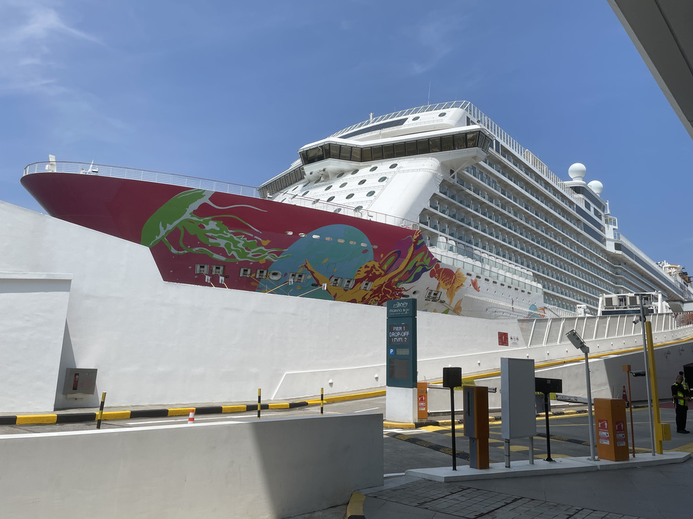
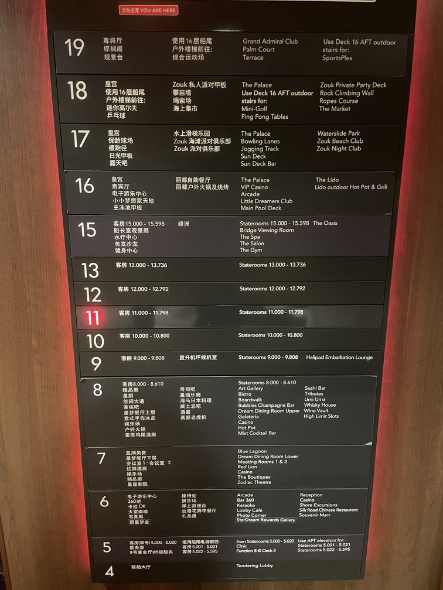
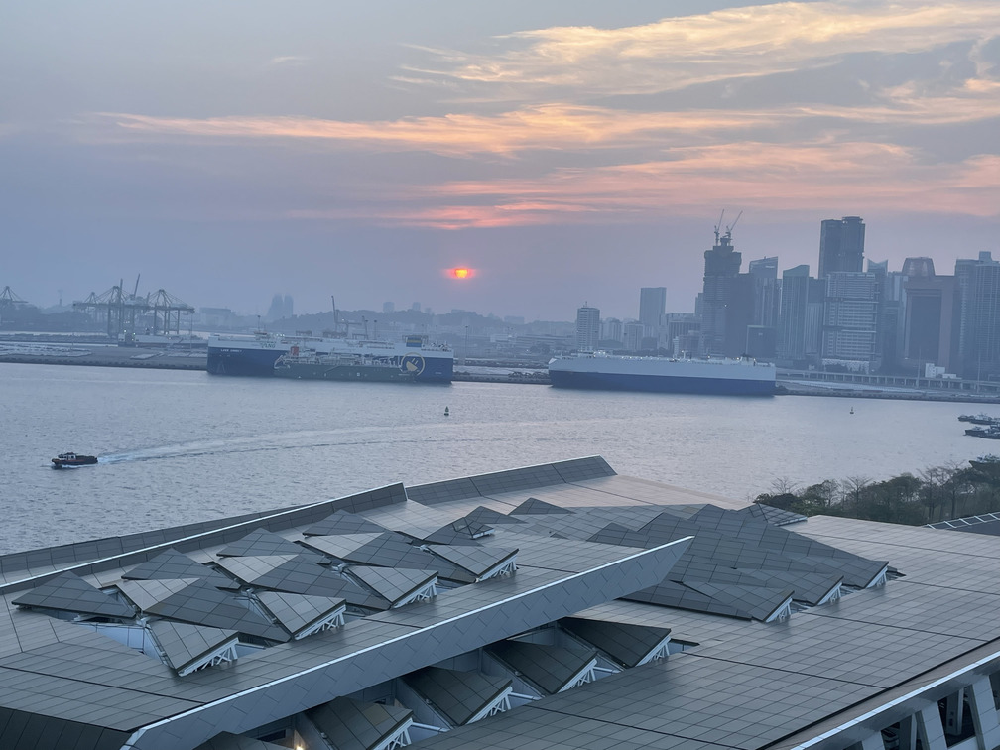
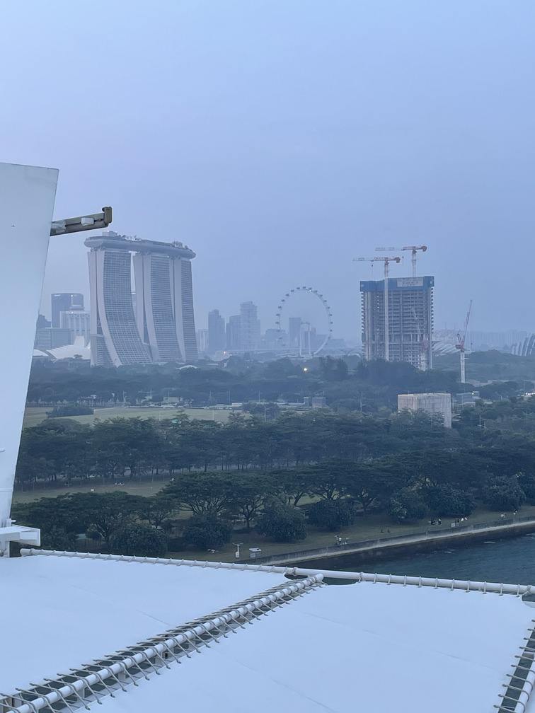
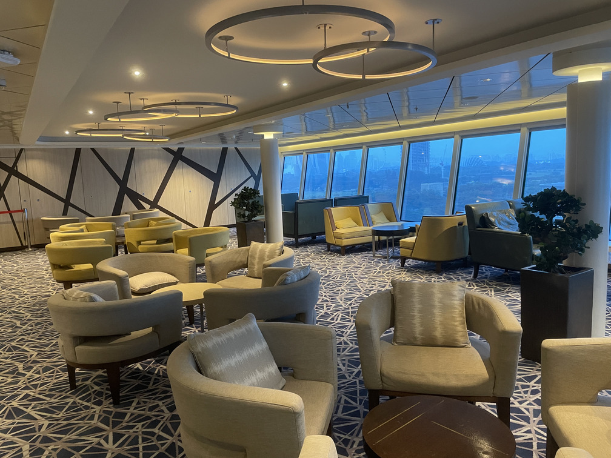
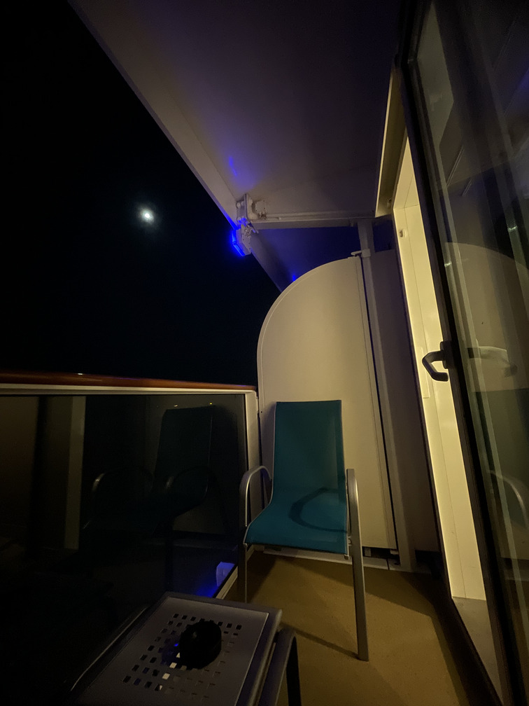
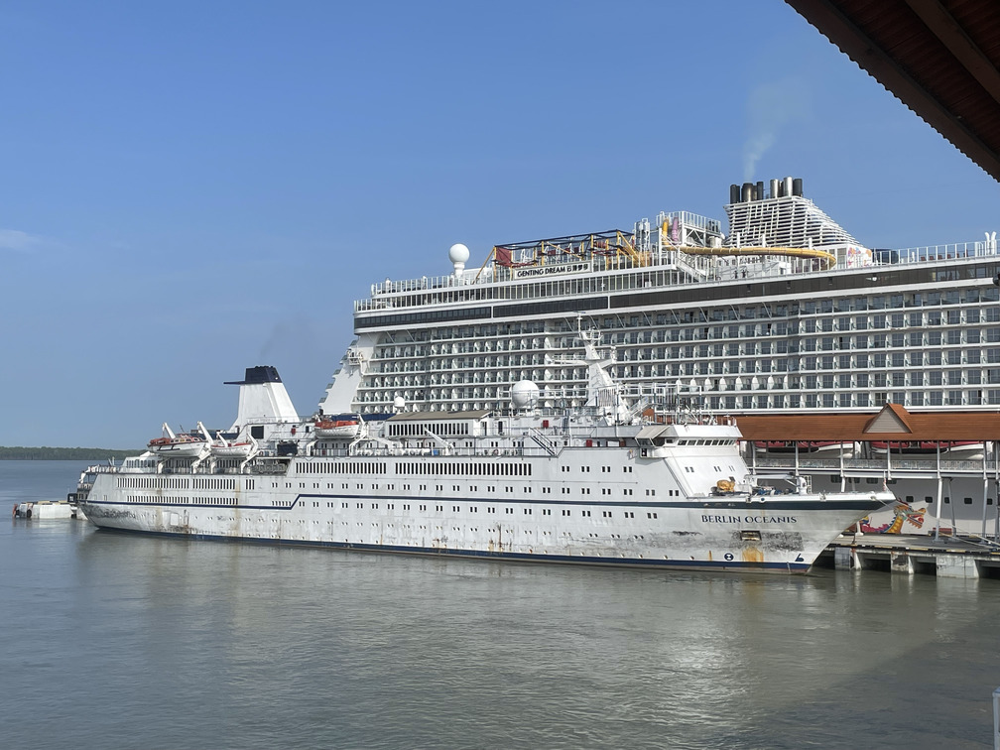
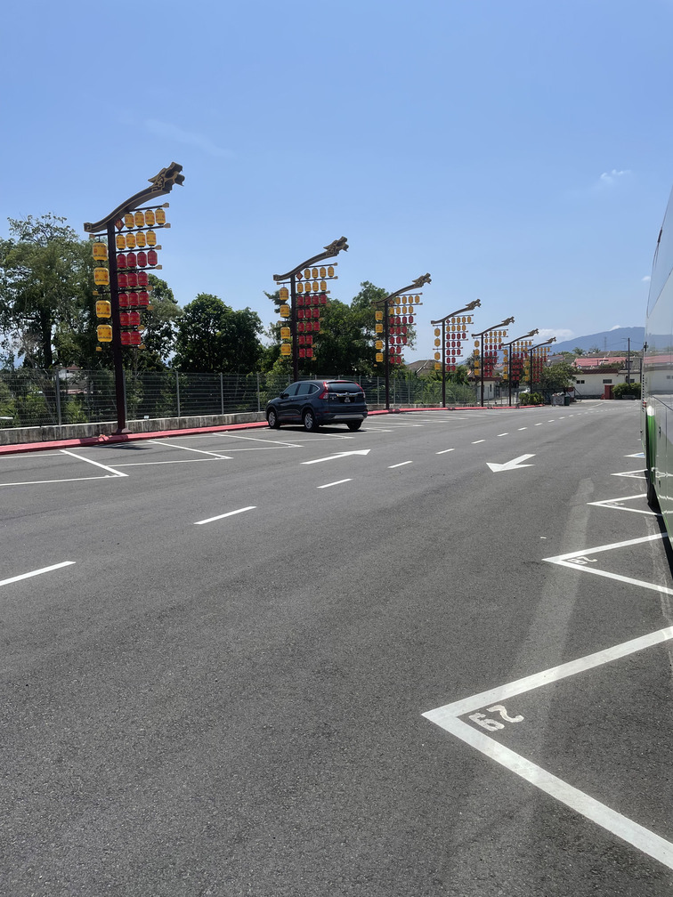

Ma famille et moi, nous nous sommes inscrits à une courte excursion de croisière de 2 jours et 1 nuit via une agence de voyage locale. L'itinéraire allait de Melaka à Singapour en bus, puis en croisière aller simple jusqu'à Port Klang. Là-bas, le même bus, qui avait roulé à l'avance pendant que nous étions en croisière, nous attendrait pour nous ramener à Melaka.

Hier matin, nous sommes arrivés au point de rassemblement du groupe de voyage. Une fois que tous les participants étaient arrivés, nous sommes montés dans un bus express et avons quitté Melaka à 7h, direction Singapour. Quand nous sommes arrivés à Yong Peng, dans l'état de Johor, vers 8h, on nous a emmenés au célèbre le Ming Ang Rest Shop pour le petit-déjeuner. C'était un endroit qui me rappelait mon enfance, et j'ai beaucoup apprécié la nourriture et le lieu. Ensuite, nous avons poursuivi notre trajet et sommes arrivés au poste-frontière de Tuas vers 13h. Le contrôle d'immigration s'est déroulé sans accroc et nous avons terminé assez rapidement, sans trop de complications. Peu de temps après, nous sommes arrivés à Resort World Sentosa. Nous y avons retrouvé ma sœur, qui nous a offert un délicieux déjeuner à l'Asian Food Hall. Nous nous sommes promenés un peu, avons visité quelques boutiques, et avons passé un excellent moment ensemble. À 13h45, nous sommes retournés au point de rendez-vous et avons dit au revoir à ma sœur, car nous partions vers le port.

Nous sommes arrivés au port après 20 minutes et avons été émerveillés par le magnifique bateau de croisière Genting Dream. C'était la première fois que je voyais un navire d'une taille aussi immense. Ensuite, nous avons dû faire la longue et interminable queue pour le contrôle des bagages et de l'immigration. La queue n'avançait pas pendant un bon moment, alors j'en ai profité pour apprendre le français avec mon livre. Elle a enfin avancé au bout d'une heure. Ensuite, je suis allé au comptoir de la croisière pour représenter ma famille et récupérer une carte de chambre pour chacun de nous. Après encore une heure, nous avons enfin pu embarquer sur le bateau de croisière. Nos passeports ont été pris en charge lors de l'embarquement et nous seraient rendus à la fin de la croisière.

Nous avons marché dans un long couloir et avons vu de nombreux canots de sauvetage alignés du côté droit du couloir. Je pense que les deux côtés du navire en ont tout autant. Même si ce n'est qu'un simple canot de sauvetage, il est en réalité assez grand et entièrement équipé. Peu après, je suis arrivé au bout du couloir et suis entré par la porte à gauche. C'était le hall d'accueil. J'ai été stupéfait. L'intérieur ressemblait à un véritable centre commercial. Il y avait des salles de conférence, de larges allées, et un hall avec 8 ascenseurs, brillamment éclairé ! On y ressentait une sensation de grandeur et de luxe. De plus, le navire comptait 19 étages au total !

Notre première destination était notre cabine, au pont 11. Pour info, les étages sur un bateau de croisière s'appellent des ponts. La taille de la cabine était plutôt convenable. Ni trop grande ni trop petite, comparable à une chambre d'hôtel 3 étoiles. La décoration et l'éclairage étaient aussi beaux que dans le hall d'accueil. J'ai adoré l'ambiance ! Ensuite, nous sommes allés dîner en premier au pont 16. C'était un restaurant buffet appelé « The Lido ». Nous avons fait la queue un moment avant d'entrer dans le restaurant et de rejoindre notre table assignée. Ils proposaient une grande variété de plats. Je me suis promené et j'ai pris du poulet, de l'agneau, du poisson, du jus d'ananas, du lait, du café et des frites. J'ai beaucoup mangé et j'étais rassasié.

Après le repas, nous sommes allés dans la zone extérieure, au même étage que le restaurant. Il y avait un petit parc aquatique et une piscine à la disposition des visiteurs. Le DJ se trouvait au centre de la zone, mixant des chansons pour dynamiser l'ambiance. Nous nous sommes promenés et avons pris des photos avec la superstructure du navire en arrière-plan. À ce moment-là, le navire était encore immobile, amarré près du port. Le coucher de soleil était à couper le souffle, et je pouvais apercevoir l'hôtel Marina Bay Sands, mais il était voilé par la brume.

Je me suis faufilé à l'intérieur de ce qui semblait être un espace de repos, avec de nombreuses chaises et tables et une décoration superbe, pour profiter de la climatisation et échapper à la chaleur.

À 20h, le bateau a enfin appareillé. Nous sommes allés au Zodiac Theatre pour assister à un spectacle gratuit offert par l'équipe du Genting Dream. C'était un spectacle incroyable et nous avons beaucoup apprécié. Ensuite, nous sommes allés explorer les autres étages. À 22h, nous sommes retournés à la cabine pour nous reposer et prendre un bain. Je me suis assis sur une chaise du balcon et j'ai regardé la mer. Il y avait beaucoup de bateaux à l'horizon. C'était la première fois que je voyais autant de bateaux avec leurs lumières allumées la nuit en mer. Je pouvais voir les étoiles scintiller dans le ciel, avec une lune gibbeuse suspendue dans le ciel sombre, illuminant la mer de douces étincelles. C'était vraiment un spectacle à admirer. J'ai aussi remarqué la lumière chaude qui émanait de la chambre à travers la porte coulissante, me procurant un sentiment de calme. J'ai savouré cette tranquillité et me suis abandonné à mes pensées pendant presque une heure.

À 23h, je suis ressorti pour continuer l'exploration, seulement avec mon père et ma mère, car mon frère dormait déjà, épuisé. Nous nous sommes promenés dans le parc à ciel ouvert pour prendre l'air. L'ambiance était animée et festive, avec beaucoup de monde qui traînait et faisait la fête avec le DJ. Certains profitaient d'une bière au bar, d'autres discutaient avec des amis et de la famille, allongés sur des transats. L'atmosphère était incroyable. Après un moment, mes parents sont retournés se reposer, tandis que je continuais à explorer le casino, aux ponts 6, 7 et 8. Il y avait de nombreuses machines à sous alignées le long du couloir, ainsi que quelques tables de mahjong et de rami sur le côté.

De plus, il y avait un spectacle de chant en direct sur la scène, au milieu de l'atrium. C'était une conception astucieuse d'entourer la scène d'un bar où les visiteurs pouvaient se reposer et se détendre s'ils s'ennuyaient de leurs machines à sous. Il y avait deux chanteurs qui reprenaient des chansons les uns après les autres, et ils avaient des voix fantastiques. J'ai été touché par leurs reprises et j'ai fini par passer une heure au 3e pont de l'atrium. Ensuite, en me promenant, j'ai vu un grand écran qui diffusait 'Into The Woods'. Je me suis joint à quelques autres personnes pour regarder le film. Après 20 minutes, je suis parti et j'ai continué à errer dans la zone du casino. Cette fois-ci, je suis passé de table en table pour observer les parties. C'était tellement fascinant de les observer. J'ai regardé des parties de blackjack, de baccara et de Texas Hold'em. C'était tellement captivant et excitant de regarder les joueurs affronter le banquier. À 1h30, je suis enfin retourné dans ma cabine pour dormir.

Ce matin, nous sommes allés au 8e étage, au restaurant appelé « Silk Road », pour le petit-déjeuner. C'était une cuisine orientale, et la nourriture était bonne. Je n'ai pas mangé beaucoup car il était encore tôt le matin. Après le repas, je suis vite retourné à la cabine pour prendre une douche et faire mes valises. Puis, à 9h, nous avons débarqué du bateau après avoir récupéré nos passeports au centre d'immigration de Port Klang.

Notre bus nous attendait déjà, et avant de retourner à Melaka, nous nous sommes arrêtés à Seremban pour visiter le [temple San Kau Tong](https://maps.app.goo.gl/PnaUxm1fTt1kk45B7) et déjeuner à proximité. Ce fut une expérience très enrichissante pour moi, et je la chéris beaucoup.

