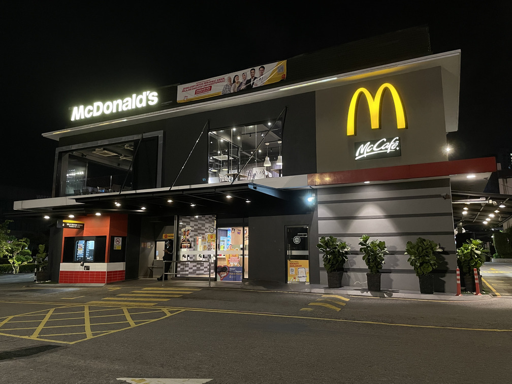
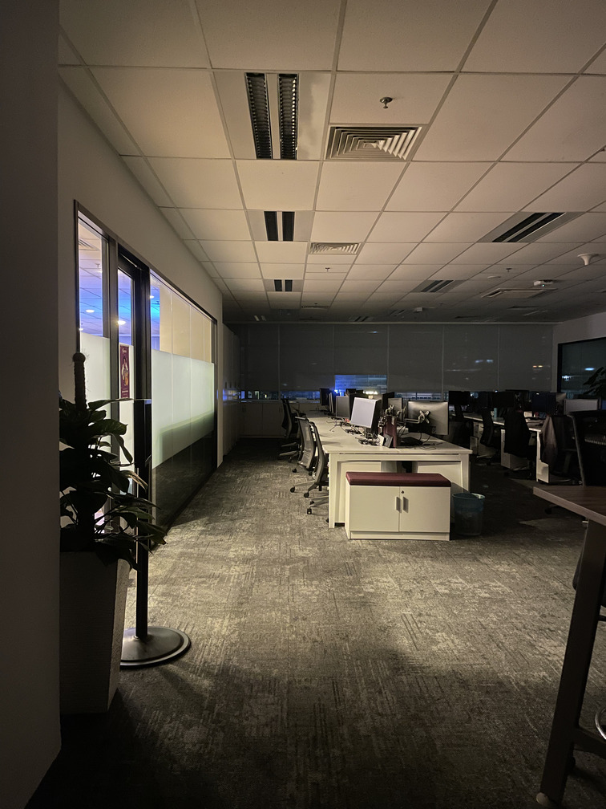

Aujourd'hui, nous sommes mecredi. Demain, c'est jeudi et je dois aller au bureau pour travailler. Je passe la nuit chez mon ami. Cependant, pour diverses raisons, je n'arrive pas à bien dormir et je me suis finalement réveillé à 1h40 du matin.

Je me sentais plutôt énergique malgré le peu de sommeil après mon réveil. Donc, j'ai décidé d'aller au bureau « tôt ». J'ai pris une douche et fait mes valises avant de partir, car c'est mon dernier jour ici et je rentrerai dans ma ville natale après le travail.

Je suis descendu dans l'immeuble et suis sorti du hall d'entrée, en me dirigeant vers ma voiture. Je suis passé devant le jardin et j'ai alors vu que les restaurants étaient toujours ouverts et qu'il y avait encore beaucoup de monde qui traînait dans les parages. C'est peut-être à cause de la saison de football, je pense.

J'ai rejoint ma voiture et j'ai chargé mes affaires dans le coffre. Je n'ai pas démarré ma voiture tout de suite, mais j'ai préféré me promener dans le quartier pour l'explorer et admirer sa beauté. Voici à quoi ressemble le quartier à 2h du matin. C'était magnifique.

Après une courte promenade dans les environs, je suis retourné à ma voiture et j'ai démarré le moteur a la fin. Avant de me rendre à mon bureau, je continue à explorer les environs en voiture. Je me suis arrêté devant une supérette ouverte 24h/24 que je n'avais jamais vue auparavant et j'ai admiré la lumière néon de l'enseigne et des alentours. J'ai pris quelques photos avant de partir.

C'est la première fois que je conduis en pleine nuit à Kuala Lumpur. J'ai vérifié l'itinéraire jusqu'à mon bureau avec Waze et j'ai choisi celui sans péage ; l'heure d'arrivée estimée est de 30 minutes.

Il n'y a pas beaucoup de voitures sur la route. Je roule lentement pour mémoriser le trajet et profiter de la conduite nocturne en ville. J'aime vraiment conduire sans embouteillages.

Je me suis arrêté à la station-service Petronas pour me reposer. Elle est ouverte 24h/24 et l'éclairage est excellent, mais il n'y a personne à la caisse. Il est fermée. J'ai constaté qu'il n'y avait qu'une seule voiture garée à côté de l'emplacement de stationnment. Je ne sais pas s'il y a quelqu'un dans la voiture. Je n'ai pas osé vérifier moi-même.

Bref, j'ai garé ma voiture derrière. Je suis descendu de ma voiture pour prendre l'air. Il faisait frais et silencieux. J'aime beaucoup de environment paisible et tranquille. J'ai pris une photo de l'incroyable immeuble en copropriété situé en face de la station-service en guise de souvenir.

J'ai décidé de faire le plein avant de reprendre la route. Heureusement, grâce à l'application Setel, je peux me servir moi-même facilement dans les stations-service ici.

Je suis arrivé devant le bureau à 3h du matin et j'ai été supris de voir autant de voitures garées si tôt. J'ai aperçu des gens au rez-de-chaussée et j'ai vite compris qu'il s'agissait d'employés de nuit. Je ne suis pas allé au bureau car il est encore tôt. À la place, je suis allé explorer les environs.

Finalement, j'ai opté pour le McDonald's du coin, car j'avais un petit creux. Je suis également choquée car je me suis rendu compte que je ne suis pas la seule cliente ici. J'ai commandé un menu sandwich et je me suis installé dans un coin. J'ai allumé mon ordinateur portable Ubuntu pour naviguer sur Internet en attendant que mon repas soit prêt. C'est aussi une expérience rafraîchissante pour moi car c'est la première fois que je mange chez McDonald's si tôt le matin.

J'ai quitté McDonald's à 5h du matin et je suis allé à mon bureau. Quand je suis arrivé à mon bureau, il faisait sombre. J'étais seul. J'ai allumé une lumière légère, juste assez pour me déplacer. J'ai vraiment apprécié le bureau plongé dans le noir et en l'absence de toute personne. L'atmospherère y était apaisante et j'ai adoré cette sensation.

J'ai fait une sieste dans ma cabine et je me suis réveillé à 8h. Ce n'était pas très confortable, mais ça allait. Quoi que ce soit, il est temps de travailler.
