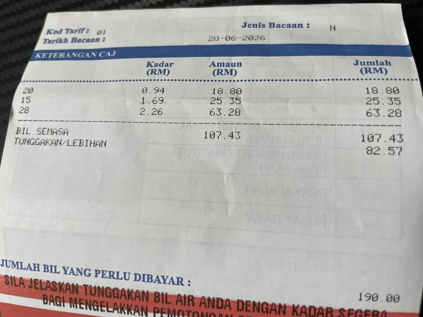

Cet après-midi, en jouant avec mes chats, j'ai remarqué une flaque d'eau dans ma cour. J'ai cru que c'était le chat qui avait renversé sa gamelle d'eau, alors je n'y ai pas prêté plus attention que ça.

Cependant, à l'heure actuelle à 20h, je me suis aperçu que la flaque d'eau est toujours là. Elle ne s'evapore pas. Une penseé horrible m'a traversé l'espirit, mais je refusais d'admettre qe la canalisation fuyait.

Il faisait nuit dehors, et je ne peux pas confirmer l'orgine de la fuite avec seulement la faible lueur d'une ampoule à incandescence éloignée de la cuisine de jardin. Je suis rentré chez moi et j'ai pris mon smartphone avec moi afin de pouvoir utiliser la lampe torche pour éclairer la zone de la fuite et confirmer mon hypothèse.

Après une inspection minutieuse, le sol autour du tuyau est mouillé, mais aucune rupture apprante n'est visible. Il pourrait s'agir de l'éclatement au niveau de la partie cachée sous terre. J'entends aussi le bruit de l'eau que coule. Je n'ai pas un bon pressentiment à ce sujet.

J'ai informé mon père du problème et je lui ai montré la fuite. Nous avons également vérifié le compteur d'eau et constanté que le débit augmentait très rapidement. Nous avons fermé toutes les vannes et le nombre a finalement cessé d'augmenter. Ce n'est pas la solution idéale, mais au moins la fuite d'eau est stopée.

De plus, le robinet et le réservoir des toilettes fuient dans la salle de bain depuis quelques mois. Or, les membres de la famille n'ont rien fait pour remédier à ce problème.

Je ne suis sentie impuissante car je ne connais rien au fonctionnement du système de tuyauterie ni à la maniére de le réparer.

À l'avenir, je devrai apprendre et pratiquer la plomberie afin de pouvoir diagnostiquer et résoudre moi-même des problèmes similaires sans avoir à faire appel à un plombier.

---

Mise à jour: Le lendemain, nous avons reçu facture d'eau et voilà cela coûtait la somme astronomique de RM107 ce mois-ci. Nous sommes si heureux, surtout mon père...

